# Logbook Tugas CPMK 3 – Instance Segmentation

## Identitas dan status

Nama : Muhammad Dayyan Ghazanfar Latief  
NRP : 5054241036  
Platform: Kaggle Notebooks (GPU T4) dan Roboflow.

| No | Komponen | Status | Bukti / file |
| --- | --- | --- | --- |
| 1 | Test set foto HP (44 foto, 679 objek) | Selesai | Project Roboflow `panoptic-indoor-segmentation-rlrwm` versi 2, `exif_foto_hp.csv` |
| 2 | Eksperimen augmentasi untuk 3 model | Selesai | `hasil_eksperimen_augmentasi.csv`, `grafik_eksperimen_augmentasi.png` |
| 3 | Hipotesis sebelum eksperimen | Selesai | Bagian Hipotesis di logbook ini |
| 4 | Analisis 5 foto gagal + eksperimen pembuktian | Selesai | `prediksi_hp/`, `galeri_prediksi.png`, `eksperimen_gagal.csv` |
| 5 | Bukti proses (log, waktu GPU, logbook, Git) | Selesai | `runs/*/results.csv`, `gpu_time_log.csv`, logbook ini |
| 6 | Deklarasi penggunaan AI | Selesai | Bagian Deklarasi AI di logbook ini |
| 7 | Demo dan tanya jawab | Belum | Fungsi `ap_kelas()` dan galeri prediksi di notebook testing |

## Hipotesis

Ditulis sebelum hasil testing v13–v17 dilihat, dengan bantuan AI. Training utama (17 Nov) berjalan tanpa hipotesis tertulis; dicatat sebagai kekurangan proses.

**Tanggal ditulis:** 17 November 2026

1. **H1 – Model:** di test set HP, YOLO11s-seg dan YOLOv8s-seg turun lebih sedikit daripada Mask R-CNN.
    - Alasan: augmentasi default YOLO jauh lebih kuat (mosaic, HSV, scale, translate), sedangkan default Mask R-CNN hanya flip horizontal. Model YOLO jadi lebih terbiasa dengan variasi cahaya dan posisi.
    - Pengecualian: pada objek besar bertepi jelas (kursi, orang), mask Mask R-CNN diperkirakan lebih rapi. RoIAlign memotong fitur per objek lalu memprediksi mask 28×28 khusus objek itu, sedangkan YOLO memakai prototype mask global beresolusi 1/4 input yang cenderung kasar di tepi.
    - Kriteria: benar jika persentase penurunan mAP50-95 Mask R-CNN lebih besar dari kedua model YOLO.
2. **H2 – Kelas:** kelas paling mudah adalah objek besar yang banyak di data latih: `person`, `chair`, `trash-bin`, `wallet`. Kelas paling sulit:
    - objek kecil (`spoon`, `cup`, `paper`, `light`), karena gambar diperkecil ke 640 px dan resolusi mask rendah;
    - kelas stuff (`wall-other-merged`, `floor-other-merged`, `ceiling-merged`), karena batasnya tidak jelas sehingga mask sering terpecah atau bocor;
    - kelas dengan kurang dari 5 objek di data latih.
    - Kriteria: dilihat dari AP per kelas di `ap_per_kelas.csv`.
3. **H3 – Augmentasi:** untuk ketiga model, penurunan skor ke test set HP paling besar pada kondisi tanpa augmentasi, lalu default, dan paling kecil pada augmentasi rancangan sendiri.
    - Alasan: augmentasi rancangan sendiri meniru kondisi sulit foto HP (cahaya redup, backlight, sudut miring, objek saling menutupi).
    - Efek terbesar diperkirakan pada Mask R-CNN, karena variasi cahaya dan rotasi baru ia lihat lewat augmentasi rancangan sendiri.
    - Di test set asli selisihnya diperkirakan kecil, seperti pilot YOLO11n (0,0886 / 0,0891 / 0,0889), karena distribusinya sama dengan data latih.
    - Kriteria: selisih minimal 0,01 mAP50-95 di test set HP dianggap berarti; di bawah itu dianggap setara, karena setiap kondisi hanya dilatih dengan satu seed.

**Evaluasi hipotesis setelah hasil keluar:** H1 benar sebagian, H2 benar sebagian, H3 salah (data: Viskom-Testing v17).

1. **H1 – benar sebagian.** Mask R-CNN memang paling lemah di HP (−6,0% vs −22,1% dan −42,4%), tapi ketiga model justru naik, bukan turun.
    - Dugaan: test asli memuat kelas yang tidak ada di data latih, dan anotasi HP berangkat dari prelabel model.
2. **H2 – benar sebagian.** AP rentang 3 model (asli / HP):
    - Benar: `person` mudah (0,33–0,36 / 0,31–0,37); `light`, `paper`, `spoon`, `wall-other-merged` sulit (≤ 0,15).
    - Salah: `chair` jatuh di HP (0,04–0,07); `trash-bin` rendah di asli (0,02–0,10); `cup` dan `floor-other-merged` tidak sesulit dugaan.
3. **H3 – salah.** Tanpa augmentasi justru terbaik untuk ketiga model di kedua test set (HP: 0,158 / 0,154 / 0,129). Rancangan sendiri tidak unggul > 0,01 dari default.
    - Dugaan: batas 1 jam GPU membuat augmentasi berat belum sempat konvergen; hanya satu seed.

## Entri logbook

| Tanggal | Kegiatan | Kendala | Keputusan | Bukti |
| --- | --- | --- | --- | --- |
| 24 Nov 2026 | Testing v13 di GPU dengan output training terbaru | Output training baru bisa dipakai setelah versinya sukses | Folder output dipilih otomatis (model selesai terbanyak) | Log v13: 9 model, 72 kelas cocok |
| 24 Nov 2026 | Training augmentasi 3 model (train_instance_seg v4), 14.917 detik | v2 gagal: secret belum dipasang; Save Version default tanpa GPU; path input salah | Secret dicentang, GPU dipilih, path dicari otomatis | Log train_instance_seg v4 |
| 24 Nov 2026 | Perbaikan orientasi foto HP | Galeri Mask R-CNN terbalik; v10 gagal (86 ukuran tak cocok) | Putar sesuai EXIF foto asli di Drive; skor HP v6–v7 tidak dipakai | Log v12: 86 diputar, 2 tegak |
| 24 Nov 2026 | Testing cadangan dengan input lama | Label `floor` tidak ada di data latih | `floor` → `floor-other-merged` khusus HP | Log v5 (gagal), v6 (sukses) |
| 24 Nov 2026 | Eksperimen augmentasi diperluas ke 3 model | Tugas meminta 3 model, sebelumnya hanya YOLO11n | Tambah run tanpa dan rancangan sendiri; default = model utama | `train_instance_seg.ipynb` bagian 6 |
| 24 Nov 2026 | Notebook dipisah (training, testing) dan EDA dibuat | Antrean GPU lama | Testing dan EDA bisa tanpa GPU | 3 notebook |
| 24 Nov 2026 | Anotasi 44 foto HP selesai | Project fork juga berisi 922 gambar asli | Gambar asli dibuang berdasarkan nama file, cek HP_COUNT = 44 | Roboflow versi 2 |
| 18–24 Nov 2026 | Foto ruangan dengan HP (48 foto, 44 dipakai) | Perlu ≥ 10 foto kondisi sulit: cahaya redup (malam, ISO 1600–2500), backlight jendela, sudut mendongak, objek bertumpuk; lokasi: kamar mandi, tangga, eskalator, kafe, ruang kelas | Dipotret di beberapa hari dan jam (pagi–malam); 44 dari 48 foto dipilih | Folder Drive "Instance Segmentation Datatest" |
| 18 Nov 2026 | Analisis run pertama | mAP test asli ± 0,10; augmentasi YOLO11n hampir tak berpengaruh | Belum ada model unggul; ada kelas yang hanya muncul di test set | Output Tugas Viskom RoboFlow |
| 17 Nov 2026 | Training pertama: YOLO11s, YOLOv8s, Mask R-CNN, pilot YOLO11n | Detectron2 gagal di-build (Python 3.13) | Ganti Mask R-CNN torchvision | Log run gabungan |
| 17 Nov 2026 | Pindah dari Colab ke Kaggle | Colab putus saat laptop mati | Kaggle Commit jalan tanpa laptop | Notebook Kaggle |
| 17 Nov 2026 | Merge kelas (74 → 72) | Banyak typo; Modify Classes berbayar | Merge di notebook; Albumentations di-uninstall | `class_counts*.csv` |
| 17 Nov 2026 | Baca tugas, tentukan variabel | - | Digit NRP 6 → augmentasi | PDF tugas slide 29–32 |

## Waktu GPU

Semua run di bawah batas 2 jam GPU per model. Sumber: `gpu_time_log.csv`.

| Tanggal | Notebook | Run | Akselerator | Waktu (menit) |
| --- | --- | --- | --- | --- |
| 24 Nov 2026 | Viskom-Testing v13 | Evaluasi semua model | GPU T4 | tidak tercatat |
| 24 Nov 2026 | Viskom-Testing v7 | Evaluasi model utama (input lama) | CPU | 86,5 |
| 24 Nov 2026 | Viskom-Testing v6 | Evaluasi model utama (input lama) | GPU T4 | 10,5 |
| 24 Nov 2026 | train_instance_seg v4 | mask_rcnn_aug_custom | GPU T4 | 60,2 |
| 24 Nov 2026 | train_instance_seg v4 | mask_rcnn_aug_none | GPU T4 | 60,0 |
| 24 Nov 2026 | train_instance_seg v4 | yolov8s_aug_custom | GPU T4 | 53,5 |
| 24 Nov 2026 | train_instance_seg v4 | yolov8s_aug_none | GPU T4 | 18,2 |
| 24 Nov 2026 | train_instance_seg v4 | yolo11s_aug_custom | GPU T4 | 34,8 |
| 24 Nov 2026 | train_instance_seg v4 | yolo11s_aug_none | GPU T4 | 20,3 |
| 17 Nov 2026 | Tugas Viskom RoboFlow | aug_custom (YOLO11n pilot) | GPU T4 | 30,2 |
| 17 Nov 2026 | Tugas Viskom RoboFlow | aug_default (YOLO11n pilot) | GPU T4 | 28,5 |
| 17 Nov 2026 | Tugas Viskom RoboFlow | aug_none (YOLO11n pilot) | GPU T4 | 12,5 |
| 17 Nov 2026 | Tugas Viskom RoboFlow | mask_rcnn_r50 | GPU T4 | 61,2 |
| 17 Nov 2026 | Tugas Viskom RoboFlow | yolov8s_seg | GPU T4 | 29,7 |
| 17 Nov 2026 | Tugas Viskom RoboFlow | yolo11s_seg | GPU T4 | 27,9 |

Total waktu notebook train_instance_seg v4: 14.917 detik (248,6 menit), termasuk download dan setup.

## Keputusan teknis

| Topik | Keputusan | Alasan |
| --- | --- | --- |
| Model | YOLO11s-seg, YOLOv8s-seg (one-stage), Mask R-CNN R50-FPN v2 (two-stage) | 3 model, 2 keluarga; ukuran s muat di batas GPU |
| Merge kelas | Kelas typo digabung (`liht` → `light`, `cuo` → `cup`, dst.), 74 → 72 | Satu objek satu nama kelas |
| Kelas HP | `floor` → `floor-other-merged` | Model tidak punya kelas `floor` |
| Tanpa augmentasi | Semua dimatikan, Albumentations di-uninstall | Ultralytics diam-diam memakai Albumentations bila terpasang |
| Augmentasi sendiri | Kecerahan ±60%, saturasi ±50%, rotasi ±15°, shear ±5°; YOLO + copy-paste 0,3, mixup 0,1 | Meniru cahaya redup, backlight, sudut ekstrem, objek menutupi |
| Keterbatasan | Mask R-CNN torchvision tanpa copy-paste, mixup, perspective | Augmentasi dibandingkan di dalam satu model |
| Batas waktu | 1 jam GPU per kondisi | Adil dan di bawah batas 2 jam |
| Orientasi HP | Piksel diputar sesuai EXIF foto asli | Ekspor Roboflow masih mendatar |
| Foto test | Hanya 44 foto HP; gambar asli di fork dibuang | Test set HP harus foto sendiri |

## Deklarasi penggunaan AI

Saya menggunakan Claude (Anthropic) lewat Claude Code untuk membantu membuat kode training, evaluasi, dan EDA. Foto diambil sendiri; anotasi polygon dikoreksi manual di Roboflow dari draf prediksi model saya sendiri (`prelabel.ipynb`).

### Prompt utama

"rombak dari awal code nya fokus penyesuaian yang bisa dipakai di kaggle"

### 1 Detectron2 gagal di-build di Kaggle

**Masalah pada kode awal:** Mask R-CNN memakai Detectron2 yang harus di-compile. Build gagal di Python 3.13 Kaggle (`Failed to build detectron2`).

**Perbaikan:** diganti `maskrcnn_resnet50_fpn_v2` dari torchvision yang tidak perlu compile.

### 2 Orientasi foto HP

**Penyebab:** foto dibaca tanpa memperhatikan EXIF, sehingga galeri Mask R-CNN terbalik dan skor HP v6–v7 tidak valid. Perbaikan pertama membaca EXIF dari file Roboflow, padahal Roboflow (tanpa Auto-Orient) sudah membuang tag itu tanpa memutar piksel; v10 gagal karena 86 gambar tidak cocok dengan ukuran anotasi.

**Perbaikan:** arah putar diambil dari EXIF foto asli di Google Drive (v12: 86 diputar, 2 sudah tegak).

### 3 CUDA out of memory pada Mask R-CNN

**Penyebab:** foto HP 12 MP membuat Mask R-CNN menempel mask berukuran 4000×3000 untuk setiap deteksi.

**Perbaikan:** foto HP dan anotasinya diperkecil ke sisi terpanjang 1280 px (bbox, area, dan polygon ikut diskalakan), ditambah `expandable_segments` agar memori GPU tidak terfragmentasi.

## Lampiran bukti

### 1. Test set foto HP

**1.1 Folder Google Drive foto asli** (48 foto, tanggal file terlihat)

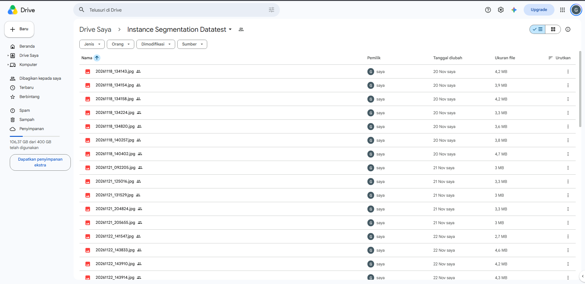

**1.1a Album "Instance Segmentation" di galeri HP** (44 foto yang dipakai sebagai test set)

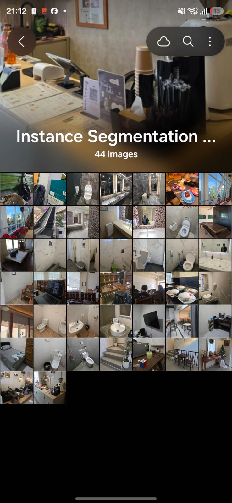

**1.2 Proses anotasi di Roboflow** (polygon sedang dibuat)

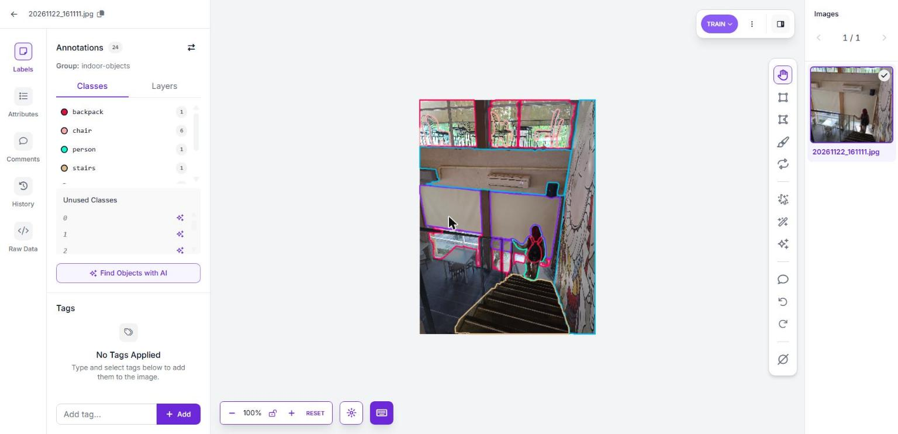

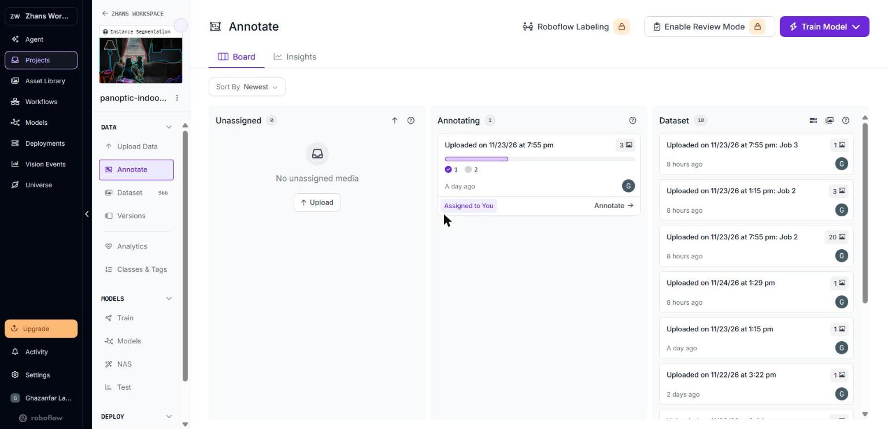

**1.3 Halaman versi 2 Roboflow** (jumlah gambar dan pengaturan preprocessing)

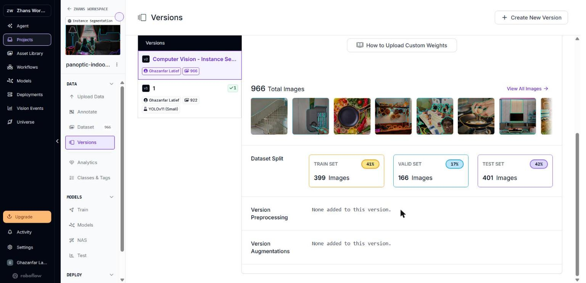

**1.4 Tabel EXIF foto HP** (`exif_foto_hp.csv`)

Samsung Galaxy S24 Ultra, 18–24 Nov 2026, ISO 32–2500, exposure 1/180–1/50 s. GPS tidak ditampilkan.

| No | File | Waktu ambil | ISO | Exposure |
| --- | --- | --- | --- | --- |
| 1 | 20261118_134143.jpg | 2026-11-18 13:41:43 | 200 | 1/180 s |
| 2 | 20261118_134154.jpg | 2026-11-18 13:41:54 | 800 | 1/100 s |
| 3 | 20261118_134158.jpg | 2026-11-18 13:41:58 | 160 | 1/100 s |
| 4 | 20261118_134224.jpg | 2026-11-18 13:42:23 | 400 | 1/100 s |
| 5 | 20261118_134820.jpg | 2026-11-18 13:48:20 | 1000 | 1/100 s |
| 6 | 20261118_140257.jpg | 2026-11-18 14:02:57 | 1250 | 1/100 s |
| 7 | 20261118_140402.jpg | 2026-11-18 14:04:02 | 1000 | 1/50 s |
| 8 | 20261121_092205.jpg | 2026-11-21 09:22:05 | 500 | 1/50 s |
| 9 | 20261121_125016.jpg | 2026-11-21 12:50:17 | 1600 | 1/100 s |
| 10 | 20261121_131529.jpg | 2026-11-21 13:15:29 | 1600 | 1/100 s |
| 11 | 20261121_204824.jpg | 2026-11-21 20:48:24 | 125 | 1/100 s |
| 12 | 20261121_205655.jpg | 2026-11-21 20:56:54 | 1600 | 1/50 s |
| 13 | 20261122_141547.jpg | 2026-11-22 14:15:47 | 80 | 1/60 s |
| 14 | 20261122_143833.jpg | 2026-11-22 14:38:33 | 1250 | 1/100 s |
| 15 | 20261122_143910.jpg | 2026-11-22 14:39:09 | 400 | 1/50 s |
| 16 | 20261122_143914.jpg | 2026-11-22 14:39:14 | 500 | 1/50 s |
| 17 | 20261122_144020.jpg | 2026-11-22 14:40:20 | 32 | 1/50 s |
| 18 | 20261122_151752.jpg | 2026-11-22 15:17:52 | 800 | 1/100 s |
| 19 | 20261122_161059.jpg | 2026-11-22 16:10:59 | 640 | 1/100 s |
| 20 | 20261122_161111.jpg | 2026-11-22 16:11:11 | 500 | 1/100 s |
| 21 | 20261122_165731.jpg | 2026-11-22 16:57:31 | 200 | 1/100 s |
| 22 | 20261123_123612.jpg | 2026-11-23 12:36:11 | 250 | 1/100 s |
| 23 | 20261123_141115.jpg | 2026-11-23 14:11:15 | 2500 | 1/100 s |
| 24 | 20261123_141354(1).jpg | 2026-11-23 14:13:54 | 200 | 1/101 s |
| 25 | 20261123_141756.jpg | 2026-11-23 14:17:56 | 640 | 1/100 s |
| 26 | 20261123_142018.jpg | 2026-11-23 14:20:18 | 640 | 1/100 s |
| 27 | 20261123_142041.jpg | 2026-11-23 14:20:41 | 800 | 1/100 s |
| 28 | 20261123_142822.jpg | 2026-11-23 14:28:22 | 250 | 1/100 s |
| 29 | 20261123_142839.jpg | 2026-11-23 14:28:39 | 500 | 1/100 s |
| 30 | 20261123_142844.jpg | 2026-11-23 14:28:44 | 800 | 1/100 s |
| 31 | 20261123_144356.jpg | 2026-11-23 14:43:56 | 64 | 1/180 s |
| 32 | 20261123_144404.jpg | 2026-11-23 14:44:04 | 400 | 1/100 s |
| 33 | 20261123_154950.jpg | 2026-11-23 15:49:50 | 250 | 1/50 s |
| 34 | 20261123_155008.jpg | 2026-11-23 15:50:08 | 250 | 1/50 s |
| 35 | 20261123_155045.jpg | 2026-11-23 15:50:45 | 100 | 1/50 s |
| 36 | 20261123_155049.jpg | 2026-11-23 15:50:49 | 250 | 1/50 s |
| 37 | 20261123_155204.jpg | 2026-11-23 15:52:04 | 200 | 1/100 s |
| 38 | 20261123_155657.jpg | 2026-11-23 15:56:57 | 80 | 1/100 s |
| 39 | 20261123_155719.jpg | 2026-11-23 15:57:18 | 80 | 1/100 s |
| 40 | 20261123_164216.jpg | 2026-11-23 16:42:15 | 160 | 1/60 s |
| 41 | 20261123_165104.jpg | 2026-11-23 16:51:04 | 250 | 1/50 s |
| 42 | 20261123_165114.jpg | 2026-11-23 16:51:14 | 1000 | 1/100 s |
| 43 | 20261123_172634.jpg | 2026-11-23 17:26:34 | 250 | 1/100 s |
| 44 | 20261124_115758.jpg | 2026-11-24 11:57:58 | 1600 | 1/50 s |

**1.5 Contoh foto kondisi sulit**

Gambar diambil dari output prediksi YOLO11s-seg (Viskom-Testing v17), jadi mask prediksi ikut terlihat.

**Cahaya redup:** `20261121_205655.jpg`, ISO 1600, 1/50 s

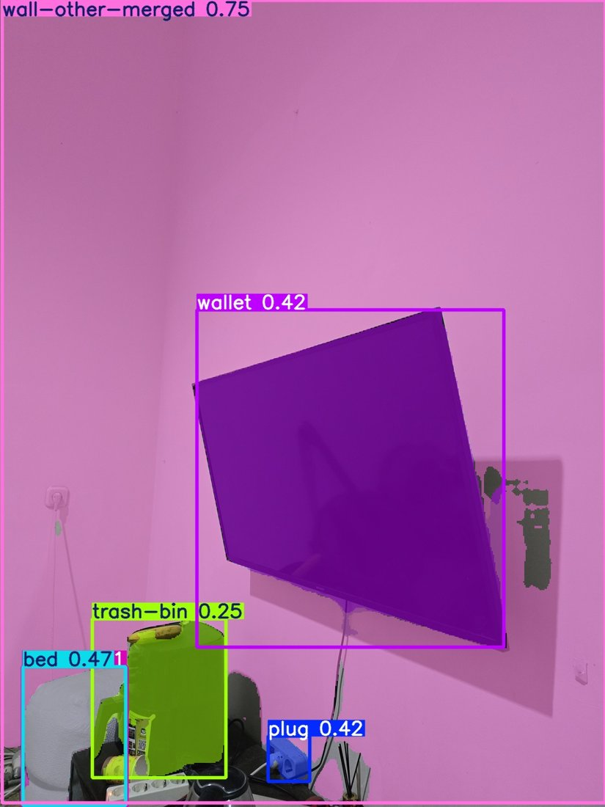

**Backlight:** `20261123_155657.jpg`, menghadap jendela terang

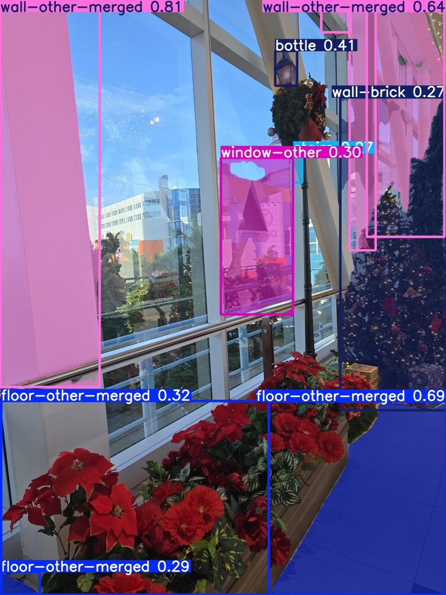

**Objek saling menutupi:** `20261123_141115.jpg`, kursi bertumpuk, ISO 2500

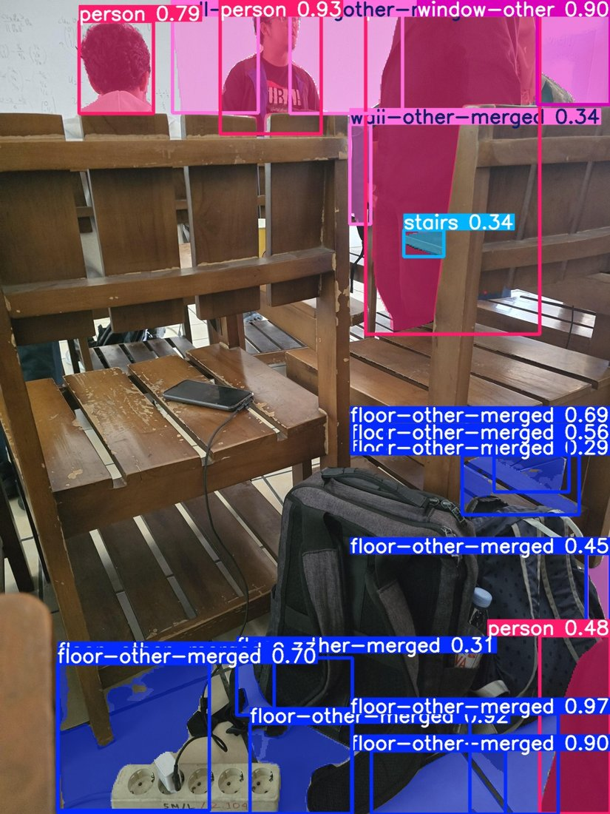

**Sudut ekstrem:** `20261122_144020.jpg`, kamera mendongak ke langit-langit

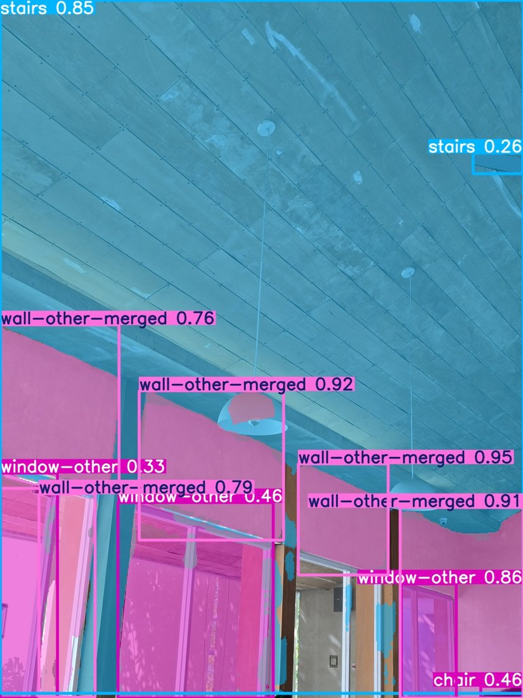

### 2. Eksperimen augmentasi

**2.1 Grafik eksperimen augmentasi 3 model** (`grafik_eksperimen_augmentasi.png`, Viskom-Testing v17)

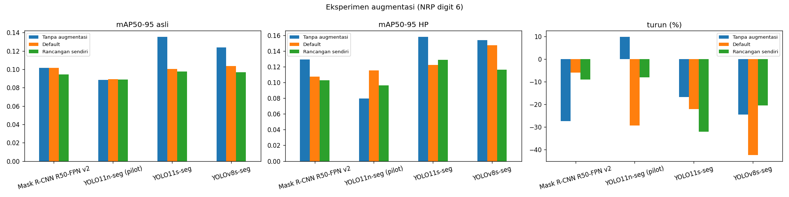

Sumber: Viskom-Testing v17 (model train_instance_seg v4).

**2.2 Tabel hasil eksperimen augmentasi** (`hasil_eksperimen_augmentasi.csv`)

Mask mAP50-95, Viskom-Testing v17. Turun (%) negatif berarti skor di foto HP justru lebih tinggi dari test set asli.

| Model | Kondisi | Test asli | Test HP | Turun (%) |
| --- | --- | --- | --- | --- |
| YOLO11s-seg | Tanpa augmentasi | 0,1352 | 0,1580 | -16,8 |
| YOLO11s-seg | Default | 0,1004 | 0,1225 | -22,1 |
| YOLO11s-seg | Rancangan sendiri | 0,0976 | 0,1289 | -32,0 |
| YOLOv8s-seg | Tanpa augmentasi | 0,1238 | 0,1541 | -24,5 |
| YOLOv8s-seg | Default | 0,1036 | 0,1475 | -42,4 |
| YOLOv8s-seg | Rancangan sendiri | 0,0967 | 0,1165 | -20,5 |
| Mask R-CNN R50-FPN v2 | Tanpa augmentasi | 0,1015 | 0,1292 | -27,4 |
| Mask R-CNN R50-FPN v2 | Default | 0,1015 | 0,1076 | -6,0 |
| Mask R-CNN R50-FPN v2 | Rancangan sendiri | 0,0944 | 0,1030 | -9,1 |
| YOLO11n-seg (pilot) | Tanpa augmentasi | 0,0886 | 0,0799 | 9,9 |
| YOLO11n-seg (pilot) | Default | 0,0891 | 0,1153 | -29,4 |
| YOLO11n-seg (pilot) | Rancangan sendiri | 0,0889 | 0,0962 | -8,1 |

**2.3 Cell ****`CUSTOM_AUG`**** di notebook training**

Dari cell 10 `training.ipynb` (train_instance_seg v4):

```python
NO_AUG = dict(hsv_h=0, hsv_s=0, hsv_v=0, degrees=0, translate=0, scale=0, shear=0,
              perspective=0, flipud=0, fliplr=0, mosaic=0, mixup=0, copy_paste=0)

CUSTOM_AUG = dict(
    hsv_v=0.6,          # cahaya redup / backlight (default 0.4)
    hsv_s=0.5,          # variasi warna lampu (kuning/putih)
    degrees=15,         # HP dipegang miring
    shear=5,
    perspective=0.0005, # sudut ekstrem (atas/bawah)
    copy_paste=0.3,     # objek saling menutupi
    mixup=0.1,
)
```

### 3. Analisis kegagalan

**3.1 Galeri prediksi 3 model** (`galeri_prediksi.png`)

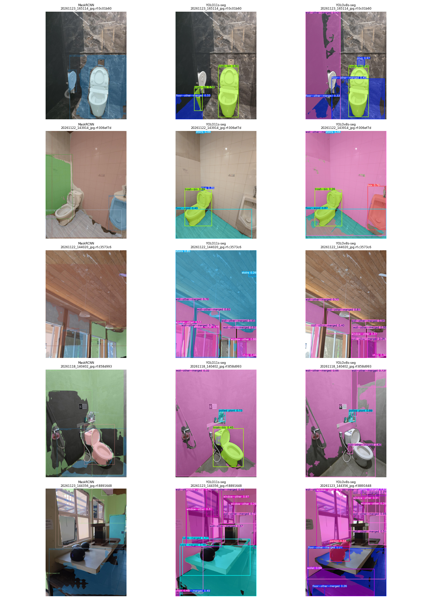

**3.2 Lima foto gagal** (tandai bagian yang gagal)

5 foto dengan AP mask rata-rata terendah (≥ 3 objek), dari `ap_per_foto_hp.csv`. Urutan: YOLO11s, YOLOv8s, Mask R-CNN.

1. `20261118_140402.jpg` – AP rata-rata 0,020; 6 objek (floor-other-merged, potted plant, toilet, vase, wall) – jenis kegagalan: salah kelas pada kelas langka (`toilet` hanya 2 objek latih) menjadi trash-bin/sink; mask dinding bocor ke lantai

    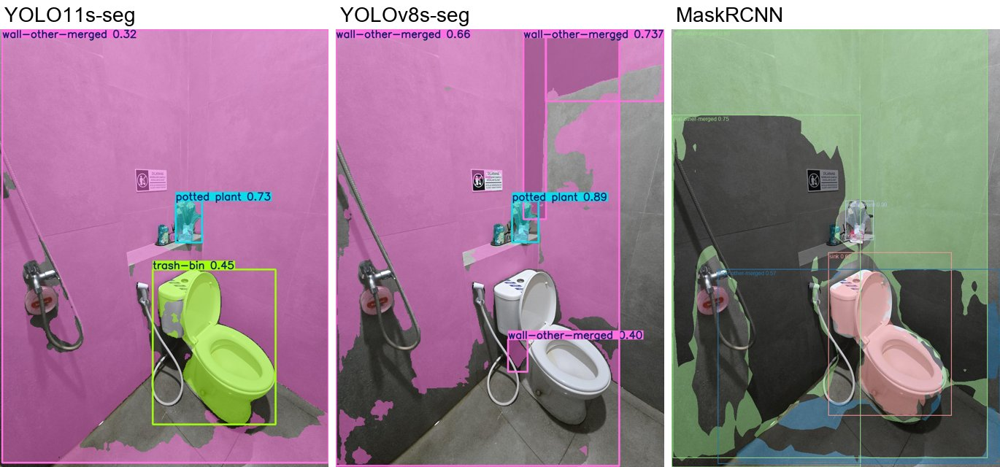
2. `20261122_143914.jpg` – AP rata-rata 0,000; 4 objek (floor-other-merged, toilet, wall-other-merged) – jenis kegagalan: salah kelas: toilet → trash-bin, urinoir → box, lantai → floor-wood; dinding tidak tersegmentasi (YOLO11s)

    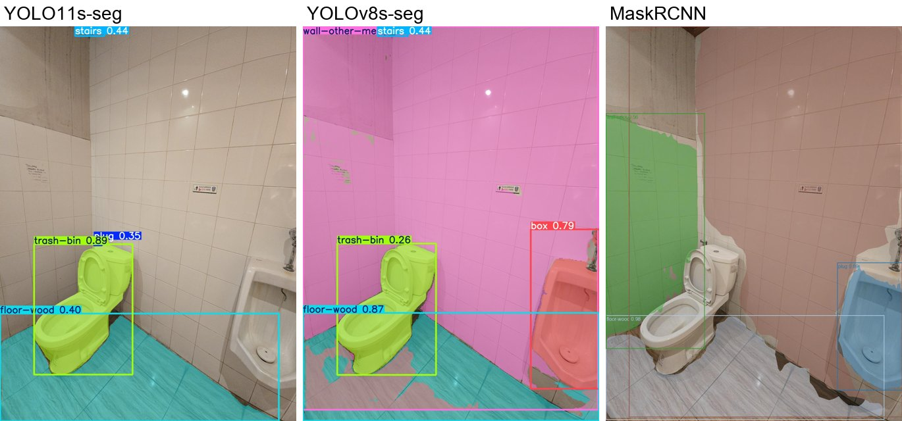
3. `20261122_144020.jpg` – AP rata-rata 0,009; 7 objek (ceiling-merged, light, wall-other-merged) – jenis kegagalan: sudut ekstrem (mendongak): langit-langit terbaca stairs atau terlewat; lampu kecil tidak terdeteksi

    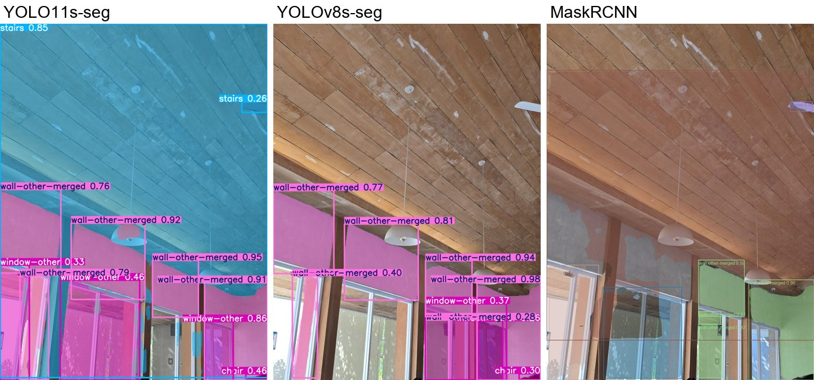
4. `20261123_144356.jpg` – AP rata-rata 0,034; 22 objek (chair, table-merged, wall-other-merged, window-blind, window-other) – jenis kegagalan: backlight jendela: window-blind terlewat, kursi hampir tidak terdeteksi; YOLOv8s membaca helm sebagai person dan meja sebagai wallet

    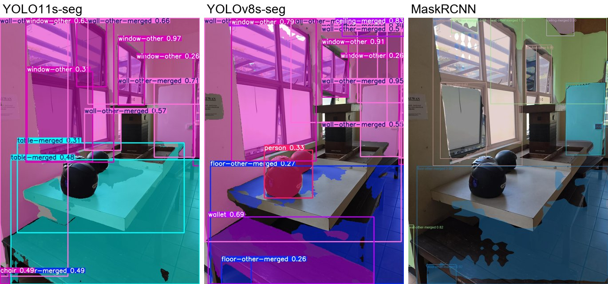
5. `20261123_165114.jpg` – AP rata-rata 0,000; 3 objek (door-stuff, toilet, wall-other-merged) – jenis kegagalan: cahaya redup + kelas langka: toilet → trash-bin, sekat kaca (door-stuff) terlewat, dinding marmer gelap tidak tersegmentasi

    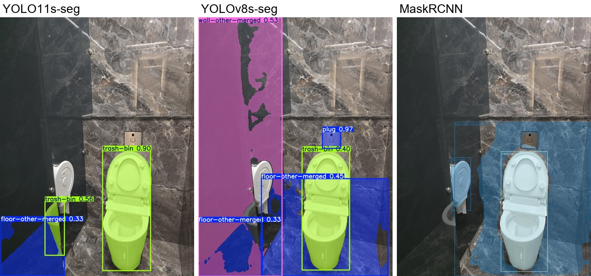

**3.3 Hasil eksperimen pembuktian** (`eksperimen_gagal.csv`, gambar 640 vs 960)

YOLO11s-seg di seluruh test set HP, mask prototype 640 px dibandingkan retina mask 960 px:

| Ukuran input | mAP50-95 HP | mAP50 HP |
| --- | --- | --- |
| 640 | 0,1225 | 0,1927 |
| 960 | 0,1265 | 0,1889 |

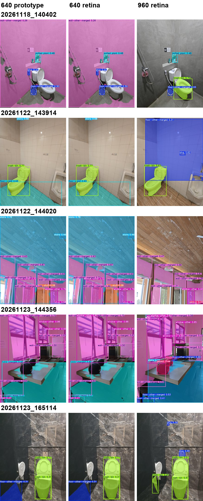

### 4. Bukti proses

**4.1 Log training train_instance_seg v4** ("Successfully ran in 14917.2s" dan baris menit GPU)

Output `training.ipynb` (v4). "Successfully ran in 14917.2s" hanya ada di log Kaggle.

```text
[yolo11s_seg] sudah selesai, skip
[yolov8s_seg] sudah selesai, skip
[mask_rcnn_r50] sudah selesai, skip
[yolo11s_aug_none] 20.3 menit GPU
[yolo11s_aug_custom] 34.8 menit GPU
[yolov8s_aug_none] 18.2 menit GPU
[yolov8s_aug_custom] 53.5 menit GPU
[mask_rcnn_aug_none] 60.0 menit GPU
[mask_rcnn_aug_custom] 60.2 menit GPU
```

**4.2 ****`gpu_time_log.csv`** di tab Output Kaggle

Isi `gpu_time_log.csv` (Tesla T4), total 437,0 menit:

| Run | Mulai | Menit |
| --- | --- | --- |
| yolo11s_seg | 2026-11-17 15:12 | 27,9 |
| yolov8s_seg | 2026-11-17 15:40 | 29,7 |
| mask_rcnn_r50 | 2026-11-17 16:09 | 61,2 |
| aug_none (YOLO11n pilot) | 2026-11-17 17:11 | 12,5 |
| aug_default (YOLO11n pilot) | 2026-11-17 17:23 | 28,5 |
| aug_custom (YOLO11n pilot) | 2026-11-17 17:52 | 30,2 |
| yolo11s_aug_none | 2026-11-24 08:58 | 20,3 |
| yolo11s_aug_custom | 2026-11-24 09:18 | 34,8 |
| yolov8s_aug_none | 2026-11-24 09:53 | 18,2 |
| yolov8s_aug_custom | 2026-11-24 10:11 | 53,5 |
| mask_rcnn_aug_none | 2026-11-24 11:05 | 60,0 |
| mask_rcnn_aug_custom | 2026-11-24 12:05 | 60,2 |

**4.3 Kurva training** (`runs/*/results.png`)

**YOLO11s-seg** (`runs/yolo11s_seg/results.png`)

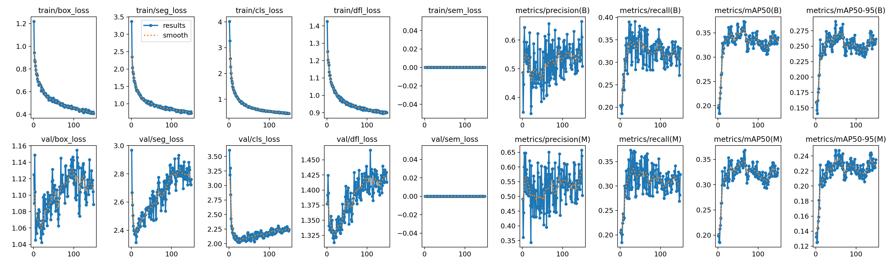

**YOLOv8s-seg** (`runs/yolov8s_seg/results.png`)

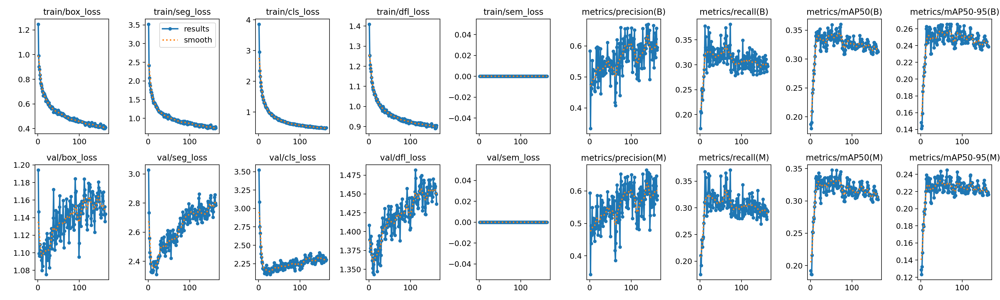

**Mask R-CNN** (`runs/mask_rcnn_r50/results.csv`, 28 epoch dalam 61,2 menit; learning rate turun ke 0,0005 di epoch 20)

| Epoch | Menit | loss_mask | val mask mAP50-95 | val mask mAP50 |
| --- | --- | --- | --- | --- |
| 1 | 2,2 | 0,690 | 0,008 | 0,014 |
| 5 | 11,3 | 0,326 | 0,102 | 0,165 |
| 10 | 22,5 | 0,225 | 0,144 | 0,227 |
| 15 | 33,5 | 0,179 | 0,173 | 0,263 |
| 20 | 44,2 | 0,152 | 0,188 | 0,276 |
| 25 | 54,9 | 0,147 | 0,189 | 0,281 |
| 28 | 61,2 | 0,143 | 0,188 | 0,285 |

### 5. Bukti kendala dan keputusan

**5.****1**** Jumlah kelas sebelum dan sesudah merge** (74 menjadi 72)

Output `eda_panoptic.ipynb` (EDA-Panoptic v1):

```text
Kelas: 74 sebelum merge, 72 setelah merge. Yang digabung: {'paper-merged': 'paper', 'scissor': 'scissors'}
```

**5.****2**** Label ****`floor`**** tidak ada di data latih**

Perbaikan di `testing.ipynb`: label `floor` di anotasi HP dipetakan ke kelas latih, lalu dicek ulang.

```text
HP_MERGE = {"floor": "floor-other-merged"}
72 kelas, cocok dengan model
```

**5.****3**** Galeri prediksi terbalik**

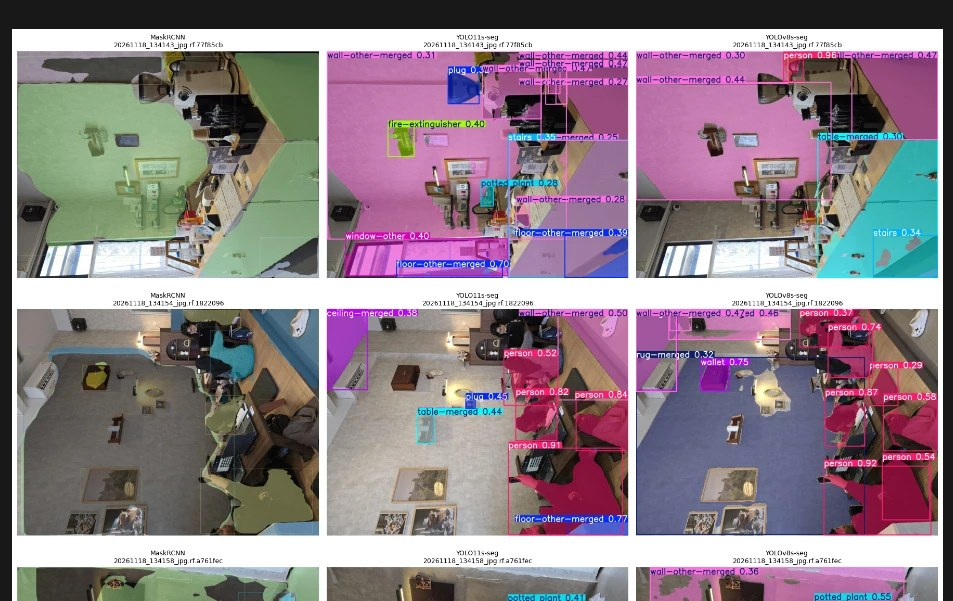

Sebelum perbaikan: foto HP dibaca tanpa memperhatikan orientasi EXIF, sehingga posisi gambar berbeda antar-model.


Sesudah perbaikan (v17): ketiga model melihat foto dalam posisi tegak yang sama.

**5.****4**** Orientasi berhasil di v12** (`'diputar': 86, 'sudah tegak': 2`)

Baris yang sama muncul di output Viskom-Testing v17 (`testing.ipynb`):

```text
Orientasi foto HP: {'diputar': 86, 'sudah tegak': 2} | 47 foto asli dibaca dari /tmp/foto_hp
44 foto HP diperkecil ke sisi terpanjang 1280 px
```